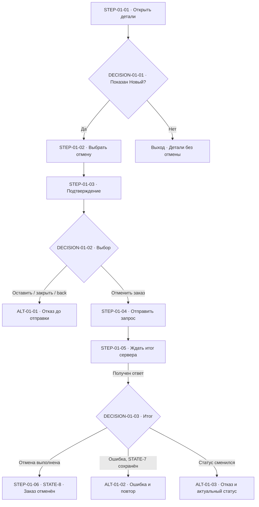
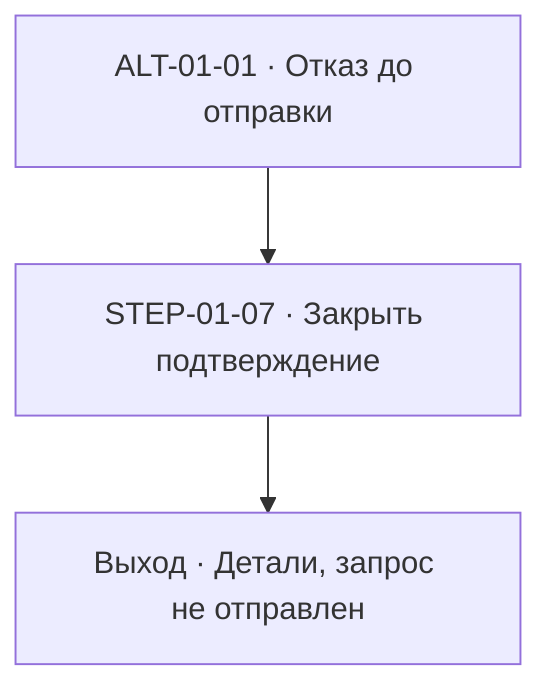
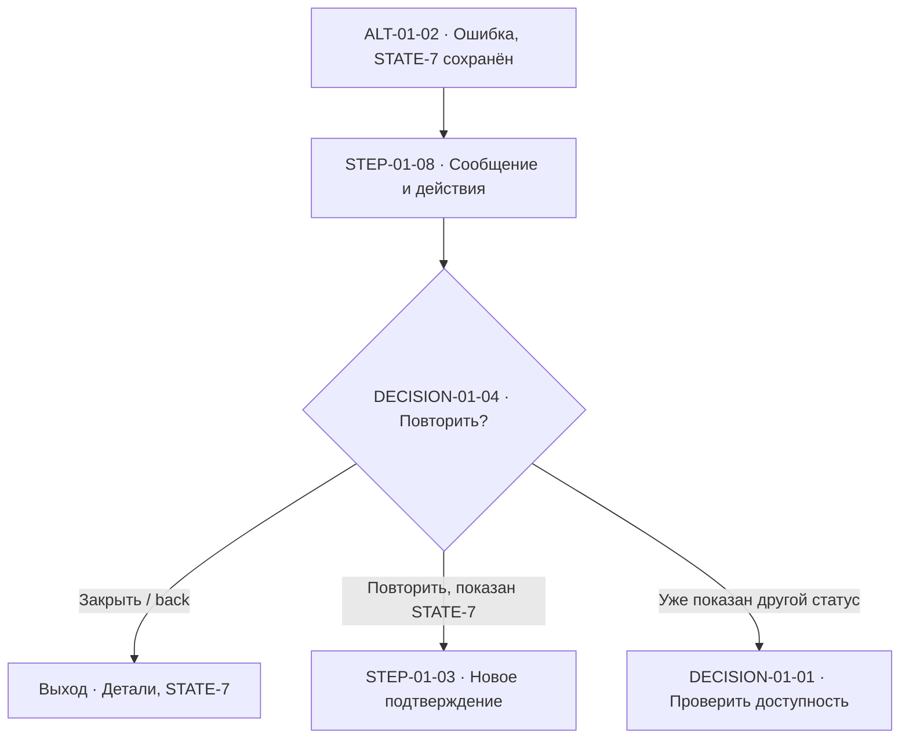
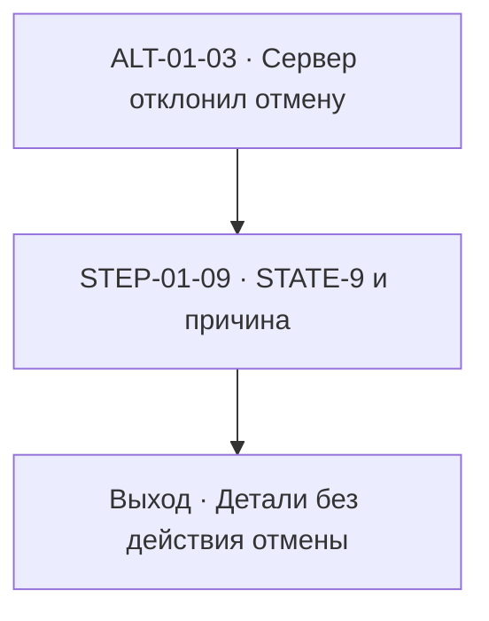

# Flow: отмена заказа

## 1. Рамка

- Status: complete — текстовая модель заявленного охвата завершена.
- Decision status: delegated — внутренние пути и тексты выбраны в явно делегированных границах; серверное RULE-7 остаётся accepted по источнику.
- Gate: LIMITED — модель готова к проектированию интерфейса и переносу; FigJam pending.
- Версия: order-cancel-flow-r1; дата: 2026-10-12; исходный контракт: order-cancel-r1.
- Цель: пользователь отменяет свой новый заказ с подтверждением и получает достоверный результат; при отказе или ошибке понимает, что произошло и как продолжить.
- Роль: владелец заказа. Система показывает детали и подтверждение, отправляет запрос и отображает подтверждённый результат. Сервер — зависимость, определяющая допустимость и итог операции.
- Точка входа: пользователь открывает детали своего заказа, первоначально находящегося в STATE-7.
- Охват: S-09 и S-10, включая отказ от подтверждения, подтверждённую ошибку и повтор, ожидание ответа, смену статуса перед подтверждением.
- Предусловия: заказ принадлежит пользователю; доступ к деталям уже получен. Вход, авторизация и заказ другого владельца не входят в эти сценарии.
- Результаты: подтверждённый STATE-8; сохранённый заказ при отказе; подтверждённый STATE-7 при ошибке с доступным повтором; актуальный STATE-9 и причина отказа при конфликте статуса.
- Платформа, дизайн-система и конкретная компоновка не заданы. Модель определяет поведение и тексты без фиксации экранной раскладки.

## 2. Источники и контракт поведения

| Источник | Locator | Дата / версия | Что подтверждает | Ограничение |
| --- | --- | --- | --- | --- |
| Согласованный контракт заказчика | `/workspace/scratch/6d77d04ed9d9/handoff-forward/input/solution.md`, «Механизм и правила», «Состояния», «Сценарии», «Границы» | order-cancel-r1; дата в документе не указана | RULE-7, STATE-7/8/9, S-09/10, делегирование путей и текста | Серверные правила менять нельзя; FigJam не подключён |
| Текущая задача | Сообщение с поручением применить flow-design и сохранить локальный flow.md | 2026-10-12 | Достаточность локального результата и целевой путь | Только предоставленный контракт и ресурсы указанного skill |
| Правила подготовки артефакта | `stages-3-7/skills/flow-design/SKILL.md`; `references/artifact-contract.md`, `flow-model-review.md`, `figjam-mcp-setup.md`, `flow-ready-checklist.md`; `assets/flow-template.md` | Прочитаны 2026-10-12 | Формат, независимые статусы, ID, проверка модели, pending FigJam | Методические правила, не источник серверного поведения |

| RULE / STATE / локальный ID | Поведение или ограничение | Источник / полномочие | Статус |
| --- | --- | --- | --- |
| RULE-7 | Только владелец может отменить свой заказ в статусе «Новый», с предварительным подтверждением. Успех → «Отменён»; ошибка → «Новый» и возможность повторить. При смене статуса отмена не выполняется; показываются актуальный статус и причина | solution.md, «Механизм и правила» | Задано, accepted |
| STATE-7 | Новый | solution.md, «Состояния» | Задано |
| STATE-8 | Отменён | solution.md, «Состояния» | Задано |
| STATE-9 | Обрабатывается | solution.md, «Состояния» | Задано |
| LOCAL-D01 | Подтверждение содержит действия «Отменить заказ» и «Оставить заказ». Закрытие подтверждения / back до отправки равно отказу; запрос не отправляется | Делегированный дизайн внутренних путей | Принято, delegated |
| LOCAL-D02 | На время отправленного запроса интерфейс показывает ожидание и блокирует повторную отправку из этого подтверждения. Это защита интерфейса, без утверждения об идемпотентности сервера | Делегированный дизайн внутренних путей | Принято, delegated |
| LOCAL-D03 | После подтверждённой ошибки «Повторить отмену» возвращает к подтверждению, затем отправляет новый запрос. Можно завершить попытку и остаться в деталях | RULE-7 + делегированный дизайн | Принято, delegated |
| LOCAL-D04 | Отображаемый статус обновляется по подтверждённому результату; локальное ожидание не превращает «Новый» в «Отменён» | RULE-7 + делегированный дизайн | Принято, delegated |
| LOCAL-D05 | Отсутствие ответа не считается подтверждённой ошибкой. Пока итог неизвестен, нет действия повторной отправки, сообщения о сохранении STATE-7 или обещания отката | Ограничение сведений источника + делегированный дизайн | Принято, delegated |

LOCAL-D* — новые локальные решения этого документа, не ID из solution.md. Ожидание и подтверждение — состояния взаимодействия, не новые серверные STATE. Существующие S-09/S-10 сохранены дословно как ID; алиасы и перенумерация не нужны.

Неизвестных обязательных правил для S-09/S-10 нет. Семантика транспортного тайм-аута, сверки неопределённого результата, сохранения запроса после refresh и серверной идемпотентности не задана. Она не заменяет явно заданную ветку подтверждённой ошибки; отдельный гарантированный recovery после потери ответа не входит в текущий контракт (см. раздел 8).

## 3. Сценарии и план покрытия

| S ID | Роль / цель / предусловия / результат | Приоритет и основание | Представление | Ограничение |
| --- | --- | --- | --- | --- |
| S-09 | Владелец открывает новый заказ, выбирает отмену и подтверждает. Успех → STATE-8; ошибка → STATE-7 и повтор; отказ от подтверждения сохраняет заказ | P0 — явно задан в контракте | FLOW-01; ALT-01-01 отказ; ALT-01-02 ошибка и повтор | Ошибка — подтверждённый результат по RULE-7, а не любой сбой транспорта |
| S-10 | Пока открыто подтверждение, заказ меняет STATE-7 на STATE-9. Подтверждение приводит к отказу сервера, показу STATE-9 и причины | P0 — явно задан в контракте | FLOW-01 / DECISION-01-03 / ALT-01-03 | Показанный до отправки STATE-7 не гарантирует доступность отмены на сервере |

В текущем контракте нет отдельных P1/P2-сценариев. Анализ применимости незаданных исключений приведён в разделах 6 и 8; они не скрывают и не заменяют P0. Компактные отклонения используют ветки одного flow, поскольку цель и точка входа остаются прежними.

## 4. Primary flow

### FLOW-01 — отменить свой новый заказ

Цель и роль: владелец отменяет свой заказ. Trigger: открытие деталей и выбор отмены. Entry point: детали своего заказа. Предусловия: принадлежность пользователю, исходный STATE-7. Связи: S-09, S-10, RULE-7, STATE-7/8/9. Основной результат: сервер подтвердил отмену, детали показывают STATE-8 и сообщение об отмене. Альтернативные результаты перечислены в разделе 5.

| STEP / DECISION ID | Исполнитель | Действие / событие | Guard / переход STATE | Обратная связь / доступные действия | Следующий узел / выход | Основание |
| --- | --- | --- | --- | --- | --- | --- |
| STEP-01-01 | Пользователь / система | Пользователь открывает детали; система показывает известный статус заказа | Свой заказ; в P0 начальный STATE-7; эффекта отмены нет | Детали и статус | DECISION-01-01 | S-09; RULE-7 |
| DECISION-01-01 | Система | Проверяет отображаемую доступность действия отмены | Показан STATE-7 → доступна отмена; показан STATE-8 или STATE-9 → недоступна | При недоступности актуальный отображаемый статус, без действия отмены | STATE-7 → STEP-01-02; иначе → выход в деталях | RULE-7; это UI guard, не серверная гарантия |
| STEP-01-02 | Пользователь | Выбирает «Отменить заказ» | Отображаемый STATE-7; серверный эффект отсутствует | Открывается подтверждение | STEP-01-03 | S-09 |
| STEP-01-03 | Система | Показывает подтверждение | STATE не меняется; сервер может независимо сменить статус | «Отменить заказ?»; «Вы уверены, что хотите отменить этот заказ?»; «Отменить заказ» / «Оставить заказ» | DECISION-01-02 | RULE-7; LOCAL-D01 |
| DECISION-01-02 | Пользователь | Подтверждает или отказывается | Подтверждение → отправка; отказ / закрытие / back до отправки → без запроса | Выбранное действие | Подтвердить → STEP-01-04; отказаться → ALT-01-01 | S-09; LOCAL-D01 |
| STEP-01-04 | Система | Отправляет запрос отмены и переводит интерфейс в ожидание | Только после подтверждения; бизнес-статус ещё не объявляется изменённым | «Отменяем заказ…»; повторная отправка из этого подтверждения недоступна; отказ от подтверждения после отправки не является откатом | STEP-01-05 | RULE-7; LOCAL-D02/04 |
| STEP-01-05 | Сервер / система | Сервер определяет допустимость и выполняет либо отклоняет запрос; интерфейс ожидает подтверждённый итог | STATE-7 может перейти в STATE-8 при успехе; сменившийся статус исключает отмену | Ожидание до результата; без ответа итог неизвестен | При ответе → DECISION-01-03; без ответа остаётся ожидание | RULE-7; S-10; LOCAL-D05 |
| DECISION-01-03 | Система | Разбирает подтверждённый исход | 1. Отмена выполнена; 2. отказ из-за смены статуса; 3. подтверждённая ошибка при сохранённом STATE-7. Эти условия исключают друг друга по смыслу результата | Достоверный итог сервера; конфликт статуса не отображается как обычная ошибка с повтором | Успех → STEP-01-06; смена статуса → ALT-01-03; ошибка → ALT-01-02 | RULE-7 |
| STEP-01-06 | Система | Обновляет детали после подтверждённой отмены | Подтверждён STATE-8; отмена уже произошла | Статус «Отменён», текст «Заказ отменён»; действие отмены недоступно | Выход: детали отменённого заказа | RULE-7; S-09; LOCAL-D04 |

Текст сообщения — наблюдаемая обратная связь, а переход STATE-7 → STATE-8 — подтверждённый серверный эффект. В модели нет автоматического повтора, оптимистического успеха или действия восстановления уже отменённого заказа.

Легенда диаграмм: прямоугольник — действие/состояние взаимодействия; ромб — выбор с условиями на рёбрах; ALT — именованная ветка раздела 5; выход — завершение пути. Все подписанные модельные ID совпадают с таблицами. Неподписанные технические имена узлов Mermaid не являются новыми ID контракта.

Без ответа STEP-01-05 остаётся состоянием ожидания; это не автоматический цикл отправки. Продолжение — только по полученному результату. Гарантированный срок ответа не заявлен.

## 5. Alternate / Exception Flows

### ALT-01-01 — оставить заказ

Ветка DECISION-01-02. Условие: «Оставить заказ», закрытие подтверждения или back до отправки. Связи: S-09, RULE-7, LOCAL-D01. Отдельный flow не нужен: отсутствует серверная операция.

| ID | Исполнитель и действие | Условие / эффект | Следующий узел / результат | Recovery / данные |
| --- | --- | --- | --- | --- |
| ALT-01-01 | Система принимает отказ | Запрос не отправляется | STEP-01-07 | Из-за этой попытки заказ не изменяется |
| STEP-01-07 | Система закрывает подтверждение | Возврат в детали; не принуждает STATE-7, если независимое обновление уже показало другой статус | Выход в деталях; новая попытка может начаться с DECISION-01-01 | Заказ сохранён; нет сообщения об успешной отмене или незаданного сохранения UI после refresh |

### ALT-01-02 — подтверждённая ошибка и повтор

Ветка DECISION-01-03. Условие: ответ подтверждает ошибку отмены и сохранение STATE-7. Связи: S-09, RULE-7, LOCAL-D03. Повтор выполняет только попытку отмены после нового подтверждения; автоматического повтора нет.

| ID | Исполнитель и действие | Условие / эффект | Следующий узел / результат | Recovery / данные |
| --- | --- | --- | --- | --- |
| ALT-01-02 | Система принимает подтверждённую ошибку | Отмена не выполнена; STATE-7 сохранён | STEP-01-08 | Этот результат разрешает повтор по RULE-7 |
| STEP-01-08 | Система показывает ошибку в контексте деталей | Статус «Новый»; текст «Не удалось отменить заказ. Заказ остался в статусе „Новый“» | DECISION-01-04 | Доступны «Повторить отмену» и «Закрыть»; заказ сохраняется |
| DECISION-01-04 | Пользователь повторяет или завершает попытку; система проверяет доступность повтора | Показан STATE-7 и выбрано «Повторить отмену» → новое подтверждение; «Закрыть» / back → детали; уже показан другой статус → проверка доступности | Повторить → STEP-01-03; завершить → выход в деталях; другой статус → DECISION-01-01 | Повтор разрешён только после подтверждённого неуспеха; новый запрос может получить конфликт статуса |

Если перед повтором интерфейс уже показал STATE-8/9, доступность отмены повторно определяется DECISION-01-01, и повтор недоступен. Если изменение ещё не отражено, серверный результат DECISION-01-03 остаётся определяющим. Блокировка повторной отправки в ожидании защищает текущий интерфейс; серверная идемпотентность не утверждается.

### ALT-01-03 — заказ уже обрабатывается

Ветка DECISION-01-03. Условие: заказ перешёл из STATE-7 в STATE-9 во время открытого подтверждения, сервер отклонил отмену. Связи: S-10, RULE-7. Отдельное представление необходимо для проверки конкуренции и отличия от повторяемой ошибки.

| ID | Исполнитель и действие | Условие / эффект | Следующий узел / результат | Recovery / данные |
| --- | --- | --- | --- | --- |
| ALT-01-03 | Система принимает отказ из-за изменившегося статуса | Отмена не выполнена; актуальный STATE-9 | STEP-01-09 | Не показывать STATE-7 и не предлагать повтор отмены |
| STEP-01-09 | Система закрывает подтверждение, обновляет детали и объясняет отказ | Статус «Обрабатывается»; текст «Заказ уже обрабатывается. Отменить можно только заказ в статусе „Новый“» | Выход в деталях; можно закрыть сообщение | Заказ остаётся в подтверждённом актуальном статусе; действий отмены нет |

## 6. Проверка модели

Проведена структурная сверка таблиц, условий ветвей, Mermaid и источника order-cancel-r1. Это проверка модели, не испытание действующего интерфейса или сервера.

| Проверка | Применимость / результат | Свидетельство | Пробел / действие |
| --- | --- | --- | --- |
| Цель и граница | PASS | Раздел 1; FLOW-01; STEP-01-06/07/08/09 | Все заданные исходы имеют наблюдаемый результат |
| Покрытие | PASS | Таблицы сценариев в разделах 3 и 6 | Оба P0, включая все исходы S-09, покрыты |
| Контракт | PASS | RULE-7; LOCAL-D01–05 | Ни один локальный выбор не меняет серверное правило |
| Исполнители | PASS | STEP-01-01–06 и ветки | Пользователь, система и сервер явно разделены; ожидание результата обозначено |
| Выбор | PASS | DECISION-01-01–04 | Смена статуса отделена от ошибки при сохранённом STATE-7; отсутствие ответа ещё не итог |
| Граф | PASS | Три диаграммы веток и основная схема | Все необходимые узлы достижимы; повтор управляется пользователем и имеет выход; ожидание — явное устойчивое состояние |
| Состояния | PASS | STEP-01-04/05/06/08/09 | Успех только по подтверждённому эффекту; ошибка и конфликт показывают разные состояния |
| Данные и возврат | PASS для заданного охвата | ALT-01-01/02/03 | До отправки нет изменения заказа; после отправки закрытие UI не обещает откат. Сохранение UI при refresh unknown |
| Async / повтор | PASS для заданного охвата | LOCAL-D02/05; STEP-01-05; DECISION-01-04 | Повтор только после подтверждённой ошибки. Нет утверждений о тайм-ауте или идемпотентности |
| Безопасное завершение | PASS | DECISION-01-01; STEP-01-09 | При STATE-9/8 отмена не предлагается; действие «Оставить заказ» не отменяет уже отправленную операцию |
| Читаемость | PASS | Разделы 4–5; легенда | Один flow и компактные ветки, без дублирования happy path |
| Паритет таблиц и Mermaid | PASS | Сверены STEP-01-01–09, DECISION-01-01–04, ALT-01-01–03 | Ссылки веток возвращаются в существующие узлы основной модели |
| Паритет FigJam | NOT_CHECKED | Раздел 7 | Доска отсутствует |

| Исключение | Применимость / статус | Основание |
| --- | --- | --- |
| Отказ в доступе / чужой заказ / истечение сессии | N/A для текущих P0 | Предусловие — детали собственного доступного заказа. Источник не задаёт вход, права других ролей и auth recovery |
| Невалидные поля / пустой результат | N/A | Форма с вводом и поиск результата отсутствуют; речь об уже открытом заказе |
| Частичное выполнение отмены | N/A для текущего охвата | RULE-7 задаёт наблюдаемые итоговые статусы заказа; частичные продуктовые эффекты не заданы. Это не утверждение об атомарности внутренних серверных операций |
| Конкуренция статуса | PASS | S-10, ALT-01-03 |
| Отказ до отправки / повтор | PASS | ALT-01-01/02 |
| Ожидание / задержанный ответ | PASS | STEP-01-05; нет ложного успеха или ошибки; ответ возобновляет обработку |
| Потеря сети / неопределённый итог | Ограничение, не определён отдельный recovery | UNKNOWN-01/02; LOCAL-D05. Не выдаётся за подтверждённую ошибку |
| Back до отправки | PASS | LOCAL-D01, ALT-01-01 |
| Back / refresh после отправки | unknown за рамками гарантированного recovery | UNKNOWN-02; не обещается откат, сохранение UI или безопасный новый запрос |

| S | FLOW / STEP / DECISION / STATE | Полнота покрытия | Ограничение / основание |
| --- | --- | --- | --- |
| S-09 | FLOW-01; STEP-01-01–06; DECISION-01-01–03; STATE-7 → STATE-8 | PASS: успех | Только серверный подтверждённый результат |
| S-09 | ALT-01-01; STEP-01-07; DECISION-01-02 | PASS: отказ от подтверждения | Запрос не отправлен; независимая смена статуса не блокируется |
| S-09 | ALT-01-02; STEP-01-08; DECISION-01-04; STEP-01-03/04; STATE-7 | PASS: ошибка, повтор и выход | Повтор не применяется к неизвестному исходу |
| S-10 | STEP-01-03–05; DECISION-01-03; ALT-01-03; STEP-01-09; STATE-9 | PASS: гонка, отказ, статус и объяснение | Отображаемый STATE-7 до отправки не даёт гарантию отмены |

## 7. FigJam board

- FigJam status: pending.
- Реальная ссылка / file ID: отсутствуют; доска не создана.
- Причина: по предоставленному контракту FigJam пока не подключён; текущая задача запрашивает доступную текстовую модель для последующего переноса.
- Подтверждённые операции записи: отсутствуют; проверка capabilities, OAuth, write-access и сохранения не выполнялась. Инструкции настройки не являются подтверждением подключения.
- Версия для будущего board: order-cancel-flow-r1, 2026-10-12.
- Секции будущей доски: Primary Flow → раздел 4; Alternate / Exception Flows → раздел 5; Contract / Scenario Coverage → разделы 2, 3, 6; легенда и статусы → разделы 1, 4, 9.
- Сохранение и паритет: NOT_CHECKED; Mermaid представляет текстовую модель, но не заменяет сохранённый FigJam.
- Условие завершения: подключить FigJam-совместимый MCP с подтверждённой записью, авторизовать аккаунт, определить доступный целевой board, перенести эту ревизию с теми же ID, получить постоянную ссылку и перечитать структуру либо экспорт для сверки условий, веток, состояний и версии. Права доступа и публичность не изменять.

## 8. Открытые вопросы и риски

Обязательных вопросов для предоставленных P0 нет; повторное согласование делегированного пути и текста не требуется.

| ID | Неизвестное / риск | Влияние | Принятое решение или условие расширения | Blocker? |
| --- | --- | --- | --- | --- |
| UNKNOWN-01 | Транспортный тайм-аут и получение фактического результата после потери ответа | Нельзя обещать сохранение STATE-7 и безопасный retry только по отсутствию ответа | LOCAL-D05: ожидание/неизвестный исход без повторной отправки. Для гарантированного сетевого recovery нужен контракт сверки результата и допустимости повторного запроса | Нет для S-09/S-10; станет blocker для расширения на гарантированный recovery после потери ответа |
| UNKNOWN-02 | Сохранение состояния UI и операции при refresh, back после отправки и повторном входе | Нельзя обещать отмену запроса, откат или восстановление ожидания | Никакая навигация после отправки не трактуется как подтверждённая ошибка или отмена операции. При расширении определить сохранение и сверку с сервером | Нет для заявленного охвата; требуется решение перед реализацией такого recovery |
| UNKNOWN-03 | Серверная идемпотентность, дополнительные эффекты отмены | Нет оснований утверждать отсутствие повторного эффекта вне подтверждённой ошибки | Только блокировка повторной отправки в текущем UI; retry в рамках RULE-7; возвраты, уведомления и другие эффекты не добавлены | Нет для заданного контракта |
| LIMIT-01 | FigJam не подключён | Визуальная доставка на доске и её паритет не подтверждены | Точное условие завершения в разделе 7 | Нет для текстовой модели; ограничивает общий gate до LIMITED |

## 9. Гейт Flow Ready

| Пункт | Результат | Свидетельство | Пробел и влияние |
| --- | --- | --- | --- |
| FLOW-G01 | PASS | Раздел 1; FLOW-01 | Цель, акторы, entry point, предусловия, результаты определены |
| FLOW-G02 | PASS | Раздел 2; RULE-7; LOCAL-D01–05 | Заданный контракт отделён от делегированных решений и unknown |
| FLOW-G03 | PASS | Разделы 1–2; DECISION-01-01/03 | Все предоставленные ограничения сохранены; UI/DS и платформа не заданы и не выдуманы |
| FLOW-G04 | PASS | STEP-01-01–06; основная диаграмма | Есть путь к подтверждённому STATE-8 |
| FLOW-G05 | PASS | Разделы 3 и 6, таблица S → узлы | Оба P0 покрыты; дополнительные приоритеты не приписаны источнику |
| FLOW-G06 | PASS | ALT-01-01/02/03; DECISION-01-02/03/04 | Значимые заданные отклонения имеют условия, результат и выход |
| FLOW-G07 | PASS | Раздел 6, «Граф»; диаграммы | Сверены достижимость, выход из повтора и явное ожидание |
| FLOW-G08 | PASS | LOCAL-D02–05; STEP-01-05; разделы 5, 8 | Нет обещаний rollback, идемпотентности или сохранения UI; неизвестный результат не выдаётся за ошибку |
| FLOW-G09 | PASS | Разделы 2–6 | Исходные ID сохранены, новые локальные ID обозначены; ссылки разрешаются |
| FLOW-G10 | PASS | Разделы 4–6 | Полная модель и соответствующие Mermaid-диаграммы включены |
| FLOW-G11 | NOT_CHECKED | Раздел 7, FigJam pending | MCP и доска отсутствуют; сохранение и место записи не подтверждены |
| FLOW-G12 | NOT_CHECKED | Раздел 7 | Нет board для сверки; паритет таблиц и Mermaid проверен отдельно |
| FLOW-G13 | PASS | Разделы 7–8 | Ограничения, unknown и условия завершения явны; blockers текущего текстового охвата нет |

Итоговый gate: **LIMITED**. Текстовая модель полна для S-09/S-10, блокирующих неизвестных в этом охвате нет. Для PASS требуется сохранить FigJam board и подтвердить его паритет с этой ревизией (FLOW-G11/G12). Для расширения на сетевой recovery или восстановление после refresh сначала необходимы ответы по UNKNOWN-01/02; текущий результат таких гарантий не заявляет.
