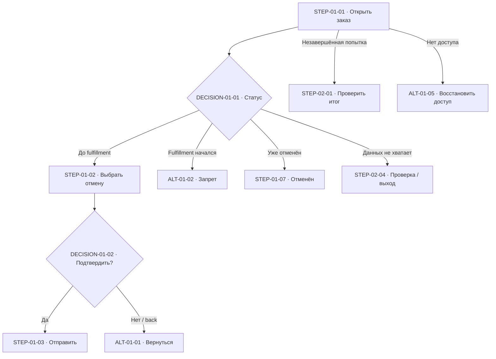
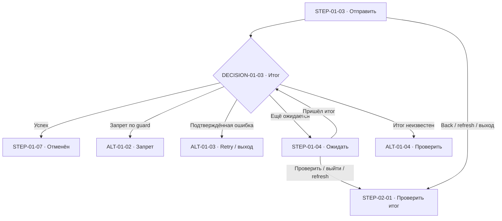
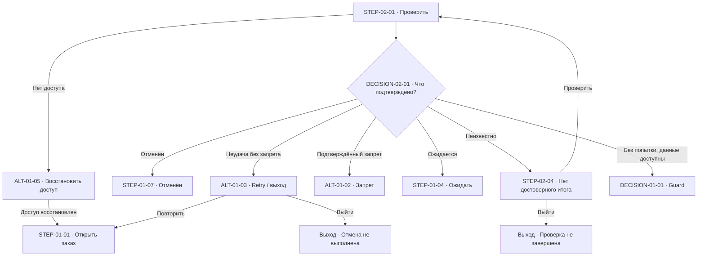

# Flow — отмена заказа покупателем

## 1. Рамка

- Цель: отменить один собственный заказ покупателя до начала fulfillment и увидеть подтверждённый результат.
- Роль: покупатель; система проверяет возможность и выполняет отмену. Отдельная роль оператора или внешней зависимости не введена.
- Охват: доступный покупателю заказ, подтверждение отмены, ожидание, запрет, ошибка, повтор, неизвестный итог и возврат к заказу. Массовые операции исключены; проблема массовых ошибок отсутствует.
- Точка входа: сведения о своём заказе, открытые покупателем. Это принятое решение пути, а не подтверждение существующего интерфейса.
- Предусловие: заказ существует и доступен покупателю. Права на чужие заказы не предполагаются.
- Результат: подтверждённая отмена с изменением статуса на «Отменён»; либо понятный выход без изменения статуса вследствие неудачной отмены; либо явно незавершённая проверка неизвестного итога.
- Версия: 1.0 / 2026-10-12. Все ID ниже локальные, впервые введены в этом файле; других документов нет.
- Итоговый статус: **LIMITED**. Текстовая модель определена; FigJam pending. Blockers модели нет.

## 2. Источники и контракт поведения

| Источник | Locator | Дата / версия | Что подтверждает | Ограничение |
| --- | --- | --- | --- | --- |
| SRC-01 | Текущий бриф: «Пользователь — покупатель… отмена разрешена только пока fulfillment не начался… если отмена не удалась, статус заказа не меняется и можно повторить» | Получен 2026-10-12 | Роль, guard отмены, эффект неудачи и право повторить | API, существующий UI, DS не предоставлены |
| SRC-02 | Текущий бриф: «Проблема массовых ошибок отсутствует, массовые операции вне scope… делегирую разумные решения пути… вопросы не задавай» | Получен 2026-10-12 | Границы и полномочие принимать решения пути | Делегация не доказывает возможности backend |
| SRC-03 | Текущий бриф: «FigJam MCP не установлен… Дай flow.md» | Получен 2026-10-12 | Ограничение визуальной доставки | Доска не создаётся |

| ID | Поведение / ограничение | Источник / полномочие | Тип |
| --- | --- | --- | --- |
| REQ-01 | Покупатель отменяет один доступный ему заказ | SRC-01, SRC-02 | Задано |
| RULE-01 | Отмена допустима только пока fulfillment не начался; проверка при отправке действия обязательна, предварительное отображение не даёт гарантии | SRC-01; проверка в момент действия выводится из ограничения | Задано |
| RULE-02 | При подтверждённой неудаче отмены статус заказа не меняется и действие можно повторить | SRC-01 | Задано |
| RULE-03 | Успешная отмена имеет системный эффект «заказ отменён», показывается только после подтверждения | SRC-01; цель действия | Задано |
| RULE-04 | Массовая отмена и массовые ошибки не входят в модель | SRC-02 | Задано |
| RULE-05 | Вход через сведения о заказе; до отправки покупатель подтверждает отмену или возвращается без действия | SRC-02, делегированный выбор | Принято |
| RULE-06 | В ожидании повторная отправка из текущего интерфейса недоступна; выход/закрытие интерфейса не обещает остановку отправленной отмены | SRC-02, делегированный выбор | Принято |
| RULE-07 | При неизвестном итоге не показывать успех/ошибку и не предлагать новую отмену до подтверждения итога текущей попытки; доступны проверка и выход | SRC-02, делегированный выбор | Принято |
| RULE-08 | После ошибки и перед повтором снова проверять guard; начало fulfillment закрывает возможность новой отмены | RULE-01, RULE-02 | Принятое выражение заданных правил |
| RULE-09 | После back/refresh/возвращения показать актуальный подтверждённый статус; при незавершённой попытке перейти к проверке её итога | SRC-02, делегированный выбор | Принято |
| STATE-01 | Fulfillment не начался; заказ не отменён. Guard допускает запрос отмены | RULE-01 | Задано |
| STATE-02 | Fulfillment начался. Отмена недоступна | RULE-01 | Задано |
| STATE-03 | Заказ отменён; подтверждённый терминальный результат этой цели | RULE-03 | Задано |
| STATE-04 | UI ожидает результат попытки; это состояние взаимодействия, не новый статус заказа | RULE-06 | Принято |
| STATE-05 | Подтверждённая ошибка отмены; статус заказа не изменён этой попыткой | RULE-02 | Задано |
| STATE-06 | Итог отправленной попытки неизвестен; это состояние знания UI, не статус заказа | RULE-07 | Принято |

Неизвестного обязательного продуктового поведения в текущем охвате нет: недостающие решения пути приняты по SRC-02. Механизм проверки завершения попытки, серверного guard и восстановления после refresh остаётся **unknown как реализация** (RISK-01); таблицы задают требуемый продуктовый результат и не утверждают наличие endpoint, polling, durable storage или idempotency. Денежные последствия не установлены и не обещаются (RISK-02).

## 3. Сценарии и план покрытия

| S ID | Роль / цель / предусловия / результат | Приоритет и основание | Представление | Ограничение |
| --- | --- | --- | --- | --- |
| S-01 | Покупатель, доступный заказ до fulfillment → подтверждённая отмена | P0: основная цель | FLOW-01 | Только один заказ |
| S-02 | Покупатель отказывается до отправки → исходный заказ без эффекта отмены | P0: безопасный выход из подтверждения | ALT-01-01 | После отправки не обещается остановка |
| S-03 | Fulfillment уже начался или начался между просмотром и отправкой → отмена запрещена | P0: обязательный guard | ALT-01-02 / DECISION-01-01, DECISION-01-03 | Запрет не подменяется retry |
| S-04 | Подтверждённая ошибка → статус не изменён; повтор или выход | P0: явный контракт | ALT-01-03 | Повтор снова проверяет RULE-01 |
| S-05 | Медленный ответ / потеря ответа или сети → ожидание / неизвестный итог / проверка | P0: не выдавать неизвестный итог за ошибку и не дублировать действие | ALT-01-04 / FLOW-02 | Нет обещания конечного времени ответа |
| S-06 | Back/refresh/возвращение после отправки → восстановление наблюдаемого результата | P0: значимый recovery | FLOW-02 | Локальный экран не считается доказательством исхода |
| S-07 | При входе заказ уже отменён → показать результат, новая отмена не нужна | P1: повторный вход | Guard DECISION-01-01 | Не вводит отдельную операцию |
| S-08 | Потеря доступа или сессии во время пути → безопасный выход, после восстановления доступа перечитать заказ | P1: граница предусловия | ALT-01-05 | Flow аутентификации не проектируется |
| S-09 | Массовые отмены / массовые ошибки | P2: явно исключено брифом | N/A по RULE-04 | Нет ветки bulk |
| S-10 | Возврат денег, действия продавца/оператора, дальнейшая доставка | P2: за пределами цели | N/A | Не обещаются сроки и эффект refund |

## 4. Primary flow

### FLOW-01 — отменить один заказ

Цель: получить подтверждённую отмену. Роль: покупатель. Trigger: желание отменить заказ. Entry point: сведения о своём заказе. Предусловие: доступ к заказу; RULE-01 проверяется по пути, а не предполагается неизменным. Связи: S-01–S-08, RULE-01–RULE-09, STATE-01–STATE-06. Результат: STEP-01-07 либо явный альтернативный выход.

| ID | Исполнитель | Действие / событие | Guard / переход STATE | Обратная связь / доступные действия | Следующий узел / выход | Основание |
| --- | --- | --- | --- | --- | --- | --- |
| STEP-01-01 | Покупатель → система | Открыть сведения о заказе; получить актуальные данные | Заказ доступен; нет изменения заказа | Текущий статус. При незавершённой попытке — её проверка | DECISION-01-01; при незавершённой попытке STEP-02-01; при потере доступа ALT-01-05 | RULE-05, RULE-09 |
| DECISION-01-01 | Система | Определить наблюдаемый статус / возможность | Уже отменён → STATE-03; fulfillment начался → STATE-02; иначе подтверждено STATE-01; данных не хватает → неизвестна возможность | Отмена доступна только при подтверждённом STATE-01 | STATE-03 → STEP-01-07; STATE-02 → ALT-01-02; STATE-01 → STEP-01-02; неизвестно → STEP-02-04 | RULE-01, RULE-03, RULE-07 |
| STEP-01-02 | Покупатель | Выбрать «Отменить заказ» | STATE-01; бизнес-эффекта нет | Подтверждение намерения; «Подтвердить» / «Вернуться к заказу» | DECISION-01-02 | RULE-05 |
| DECISION-01-02 | Покупатель | Подтвердить или отказаться | До отправки запроса | Ясно, что подтверждение запускает отмену | Подтвердить → STEP-01-03; отказаться/back → ALT-01-01 | RULE-05 |
| STEP-01-03 | Система | Отправить попытку отмены и показать ожидание | UI → STATE-04; статус заказа не меняется оптимистически | «Отменяем заказ»; повторная отправка недоступна; можно выйти к заказу | DECISION-01-03; back/refresh/выход → FLOW-02 | RULE-06, RULE-09 |
| DECISION-01-03 | Система | Получить подтверждённый итог действия с соблюдением guard на момент выполнения | Успех → STATE-03; подтверждённый запрет по RULE-01 → STATE-02 без эффекта отмены; иная подтверждённая неудача → STATE-05; результат ещё ожидается → STATE-04; результат потерян/неизвестен → STATE-06 | Ожидание отдельно от ошибки и неизвестного итога | Успех → STEP-01-07; запрет → ALT-01-02; ошибка → ALT-01-03; ожидание → STEP-01-04; неизвестно → ALT-01-04 | RULE-01–RULE-03, RULE-06–RULE-07 |
| STEP-01-04 | Система | Продолжить ожидание | STATE-04; нет нового запроса отмены | Текущее ожидание; «Проверить статус» / выход к заказу | При новом подтверждённом результате DECISION-01-03; проверить/выход/refresh → STEP-02-01 | RULE-06, RULE-09 |
| STEP-01-07 | Система | Показать подтверждённо отменённый заказ | STATE-03; эффект отмены уже произошёл | Статус «Отменён»; сведения о заказе доступны; новой отмены нет | Терминальный успех FLOW-01 | RULE-03 |

Легенда Mermaid: прямоугольник — шаг/результат, ромб — выбор; ID разрешаются в таблицах. Разрыв диаграммы на два блока нужен для читаемости; соединяющий узел STEP-01-03 один и тот же.

## 5. Alternate / Exception Flows

Ветки компактно дополняют FLOW-01; recovery неизвестного итога выделен в FLOW-02, поскольку отличается цель и последовательность.

| ID | Исполнитель и действие | Условие / эффект | Следующий узел / результат | Recovery / данные |
| --- | --- | --- | --- | --- |
| ALT-01-01 | Покупатель возвращается к заказу | DECISION-01-02: отказ до отправки. Бизнес-эффекта нет | STEP-01-01 или выход | Заказ сохранён; отмена не отправлялась; намерение подтверждения не требуется сохранять |
| ALT-01-02 | Система сообщает, что fulfillment начался и отмена недоступна | DECISION-01-01 или подтверждённый запрет DECISION-01-03. Отмена не меняет статус | Сведения о заказе / безопасный выход | Нет новой отмены, пока действует запрет. Обновление данных не отменяет RULE-01; отдельные возможности возврата не придуманы |
| ALT-01-03 | Система показывает подтверждённую ошибку и покупатель выбирает повтор/выход | STATE-05, RULE-02. Неудачная попытка не изменила статус | Повтор → STEP-01-01; выход → сведения о заказе / завершение без отмены | Повторяем только попытку отмены после актуальной проверки и подтверждения. Новый guard может запретить отмену. Причину показываем, если она известна; массовой обработки ошибок нет |
| ALT-01-04 | Система сообщает «Результат отмены пока неизвестен» | Потеря сети/ответа после отправки либо исход нельзя подтвердить → STATE-06 | STEP-02-01 | Не утверждаем неизменность статуса при неизвестном итоге. Новая отмена недоступна до подтверждения завершения; уже отправленное действие может завершиться |
| ALT-01-05 | Система сообщает об утрате доступа; покупатель восстанавливает доступ обычным способом или выходит | Заказ недоступен / сессия истекла на любом шаге | После восстановления доступа STEP-01-01; иначе безопасный выход | Новая отмена не отправляется без доступа. Если запрос уже ушёл, вход после восстановления ведёт к FLOW-02; потеря сессии не означает отмену запроса |

### FLOW-02 — проверить итог и вернуться к заказу

Цель: восстановить достоверное представление о заказе/попытке. Роль: покупатель. Entry: STEP-01-04, ALT-01-04, back/refresh/возвращение или потеря данных при входе. Связи: S-05, S-06, S-08; RULE-06, RULE-07, RULE-09; STATE-04, STATE-06. Принятое решение: проверка не повторяет отмену. Конкретный API и механизм связи с попыткой не утверждаются.

| ID | Исполнитель и действие | Условие / эффект | Следующий узел / результат | Recovery / данные |
| --- | --- | --- | --- | --- |
| STEP-02-01 | Система проверяет актуальный заказ и, при отправленной попытке, её итог | Проверка является чтением/сверкой, не новой отменой | DECISION-02-01; нет доступа → ALT-01-05 | Использовать подтверждённые сведения; не полагаться на исчезнувший экран ожидания |
| DECISION-02-01 | Система различает подтверждённые исходы | Заказ подтверждённо отменён; либо попытка подтверждённо не удалась; либо попытка ожидается; либо итог неизвестен. При входе без попытки — только актуальный guard заказа | Отменён → STEP-01-07; неудача → ALT-01-03 или ALT-01-02 при запрете; ожидается → STEP-01-04; неизвестно → STEP-02-04; без попытки и данные доступны → DECISION-01-01 | Сам по себе видимый прежний статус не доказывает завершение отправленной попытки и не разблокирует новую отмену |
| STEP-02-04 | Система показывает отсутствие достоверного итога/данных; покупатель выбирает проверку или выход | STATE-06 для отправленной попытки; иначе неизвестна возможность отмены | «Проверить статус» → STEP-02-01; «Вернуться к заказу» / закрыть → безопасный выход с незавершённой проверкой | Повторять можно проверку. Новая отмена недоступна до достоверного исхода/guard. Нет гарантии автоматического завершения или срока |

Условия циклов: ожидание завершается подтверждённым итогом или выходом в проверку; проверка повторяется только по выбору покупателя, имеет безопасный выход и не создаёт новых отмен; retry запускается после подтверждённой ошибки и вновь проходит guard. Никакая ветка не обещает откат после успеха. Если одновременно получены несовместимые сведения, итог считается неизвестным до сверки; успех показывается только при подтверждённой отмене.

## 6. Проверка модели

| Проверка | Применимость | Свидетельство | Пробел / действие |
| --- | --- | --- | --- |
| Цель и граница | Да | §1, FLOW-01, STEP-01-07 | Нет |
| Покрытие | Да | Таблица ниже, S-01–S-10 | Нет непокрытого P0 |
| Контракт | Да | RULE-01–RULE-09; SRC-01–SRC-03 | API не объявлен существующим |
| Исполнители | Да | Таблицы FLOW-01/FLOW-02 | Системный результат отделён от действия покупателя |
| Выбор | Да | DECISION-01-01/02/03, DECISION-02-01 | Неизвестное отдельно от ошибки; guard повторяется |
| Граф | Да | Все next-ссылки разрешаются; Mermaid совпадает с таблицами | Циклы имеют выход; зарезервированные номера не требуют фиктивных шагов |
| Состояния | Да | STATE-01–STATE-06, STEP-01-03/07 | Ожидание/ошибка UI не подменяют статус заказа |
| Данные | Да | ALT-01-01/03/04/05, FLOW-02 | Не обещается сохранение локального подтверждения или автоматический resume |
| Async / повтор | Да | STEP-01-04, FLOW-02, RULE-02/06/07 | Нет доказанной серверной idempotency; UI блокировка не выдаётся за неё |
| Частичное выполнение | N/A | Одно действие над одним заказом; результат отмены подтверждён/неудачен/неизвестен | Частичный bulk-успех отсутствует по RULE-04; промежуточные backend-операции не придуманы |
| Невалидный ввод / пустой результат | N/A / да | Нет редактируемого ввода; отсутствие достоверных данных → STEP-02-04 | Недоступный заказ → ALT-01-05; данные не трактуются как разрешение |
| Конкуренция | Да | RULE-01, DECISION-01-03, ALT-01-02 | Начало fulfillment после просмотра приводит к запрету; конкретная серверная синхронизация не задана |
| Безопасное завершение | Да | ALT-01-01/02/05; STEP-02-04 | Выход после отправки не отменяет эффект |
| Читаемость | Да | Три компактные Mermaid-схемы, stable ID | Нет дублирующих flow |
| Паритет представлений | Текст / Mermaid: да; FigJam: pending | ID и ветви таблиц сопоставлены с тремя схемами | Для FigJam нужна сохранённая доска и сверка |

| S | FLOW / STEP / DECISION / STATE | Полнота покрытия | Ограничение / основание |
| --- | --- | --- | --- |
| S-01 | FLOW-01; STEP-01-01/02/03/07; DECISION-01-01/02/03; STATE-01/03/04 | Полное P0 | Одиночный заказ |
| S-02 | FLOW-01; DECISION-01-02; ALT-01-01 | Полное P0 | Только до отправки |
| S-03 | DECISION-01-01/03; ALT-01-02; STATE-02 | Полное P0 | Guard обязателен в момент действия |
| S-04 | ALT-01-03; STEP-01-01; STATE-05 | Полное P0 | Retry только после подтверждённой неудачи |
| S-05 | STEP-01-04; ALT-01-04; FLOW-02; STATE-04/06 | Полное P0 | Неизвестный исход имеет recovery и выход |
| S-06 | RULE-09; STEP-01-01; FLOW-02 | Полное P0 | Не обещает локальную персистентность |
| S-07 | DECISION-01-01; STEP-01-07; STATE-03 | Покрыт P1 guard | Нового действия нет |
| S-08 | ALT-01-05; STEP-01-01; FLOW-02 | Покрыт P1 границей и recovery | Аутентификация — вне отдельного дизайна |
| S-09 | RULE-04 | Обоснованное исключение P2 | Массовые операции вне scope |
| S-10 | §1; RISK-02 | Обоснованное исключение P2 | Не определены денежные и последующие операции |

## 7. FigJam board

- **FigJam status: pending**.
- Реальная ссылка / file ID: отсутствуют; доска не создавалась.
- Причина: по SRC-03 FigJam-совместимый MCP не установлен. Не выполнялась установка, авторизация или запись; Mermaid не выдаётся за FigJam.
- Версия для будущей доски: 1.0 / 2026-10-12; реальная версия board отсутствует.
- Подтверждённые операции FigJam: отсутствуют в предоставленном окружении.
- План секций: Primary Flow ↔ §4; Alternate / Exception Flows ↔ §5; Contract / State Model ↔ §2; Coverage ↔ §3/§6. Использовать те же ID и легенду.
- Сохранение и паритет доски пока не проверены. Для завершения: подключённый FigJam-совместимый MCP с подтверждённой записью, авторизация и право на согласованную доску; создать и сохранить модель, получить постоянную ссылку/file ID, перечитать или проверить export/preview и сверить ID, условия, исходы и версию с этим файлом.

## 8. Открытые вопросы и риски

Вопросы пользователю не задаются по SRC-02. Решения пути приняты в пределах контракта.

| ID | Неизвестное / риск | Влияние | Принятое решение / условие | Blocker? |
| --- | --- | --- | --- | --- |
| RISK-01 | unknown: конкретные API guard, подтверждения итога попытки и восстановления после refresh | Требует проверки при реализации; локальный UI не доказывает возможности backend | Модель требует соблюдения RULE-01 и достоверной сверки; до неё показывать STATE-06 и блокировать новый запрос. Не обещаны idempotency, polling, автоматический resume, сроки и постоянное хранение клиента | Нет для проектирования; несовместимый API будет blocker реализации |
| RISK-02 | unknown: возврат денег и его сроки | Нельзя показывать обещание refund как эффект отмены | Вне scope S-10; сообщать только отмену заказа | Нет |
| RISK-03 | Неизвестный итог может сохраняться неопределённое время | Пользователь не может безопасно начать новую попытку до подтверждения завершения | STEP-02-04: проверка/выход; нет ложного успеха/ошибки; гарантия доступности не придумана | Нет; ограничение recovery явно видно |
| RISK-04 | FigJam не создан | Визуальная доставка и её паритет не завершены | Точное условие в §7 | Нет blocker текстовой модели; ограничение гейта |

Отмена, которая не удалась, сохраняет статус по RULE-02. Независимые изменения заказа не определяются этой попыткой: актуальную возможность перед повтором проверяем заново. Неизвестный итог не называем неудачей и потому не применяем к нему гарантию RULE-02 преждевременно.

## 9. Гейт Flow Ready

| Пункт | Статус | Свидетельство | Пробел и влияние |
| --- | --- | --- | --- |
| FLOW-G01 | PASS | §1, FLOW-01 | Цель, роль, вход, предусловие и результат определены |
| FLOW-G02 | PASS | SRC-01–SRC-03; RULE-01–RULE-09; RISK-01 | Заданные правила отделены от делегированных решений и реализации |
| FLOW-G03 | PASS | RULE-01/02/04; предусловие §1 | Другие UI/DS/платформенные ограничения не предоставлены и не выдуманы |
| FLOW-G04 | PASS | FLOW-01 → STEP-01-07 | Подтверждён системный эффект, а не только сообщение |
| FLOW-G05 | PASS | §3, §6: S-01–S-06 | Все P0 покрыты; исключения обоснованы |
| FLOW-G06 | PASS | ALT-01-01–ALT-01-05, FLOW-02 | Значимые отклонения и recovery описаны |
| FLOW-G07 | PASS | §6 «Граф», §5 условия циклов | Нет непреднамеренных тупиков; выход с неизвестным итогом обозначен |
| FLOW-G08 | PASS | STATE-04/05/06; RULE-06/07/09; FLOW-02 | Не обещается rollback; неизвестный итог отделён от ошибки; retry проверяет guard |
| FLOW-G09 | PASS | Таблицы §2–§6 | Локальные стабильные ID; ссылки разрешаются; покрытие заполнено |
| FLOW-G10 | PASS | §2–§6, три Mermaid-схемы | Полная текстовая модель; таблицы содержат детали |
| FLOW-G11 | LIMITED | §7, SRC-03 | Нет установленного MCP и сохранённой доски |
| FLOW-G12 | LIMITED | §7 | Паритет FigJam невозможен до создания/перечитывания доски |
| FLOW-G13 | PASS | §7–§8 | Ограничения, unknown реализации и условия завершения явны; blockers модели нет |

**Итог: LIMITED.** Текстовая модель готова для заявленного охвата. Гейт не PASS: FigJam pending. Для закрытия FLOW-G11/G12 выполнить условия §7; API-возможности перед реализацией проверить по RISK-01 без подмены принятых требований доказанным backend-контрактом.
